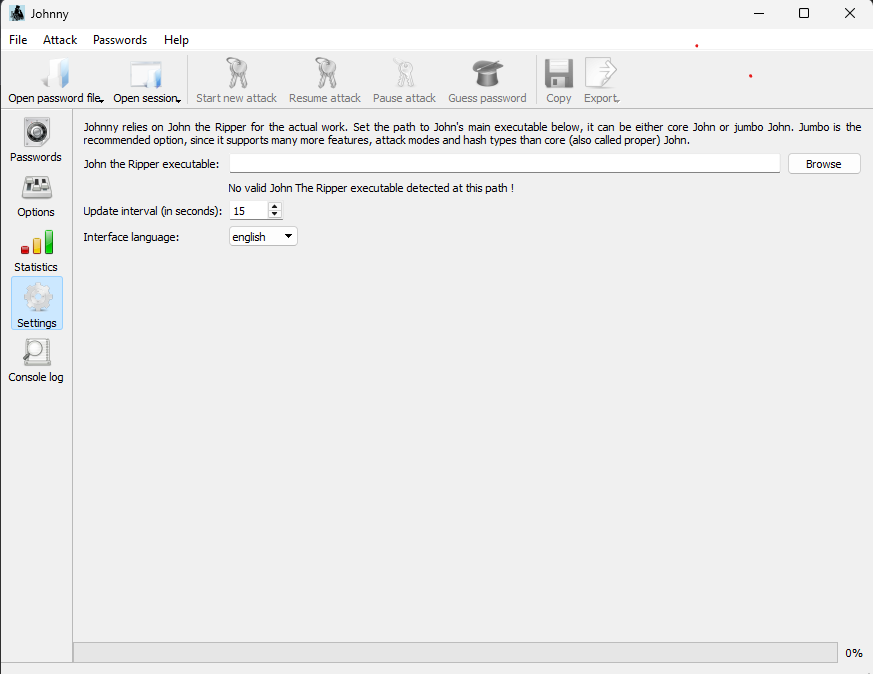
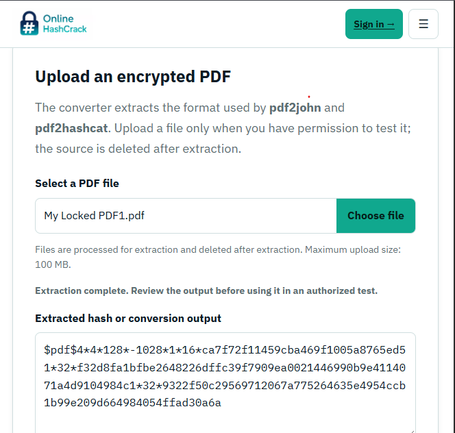
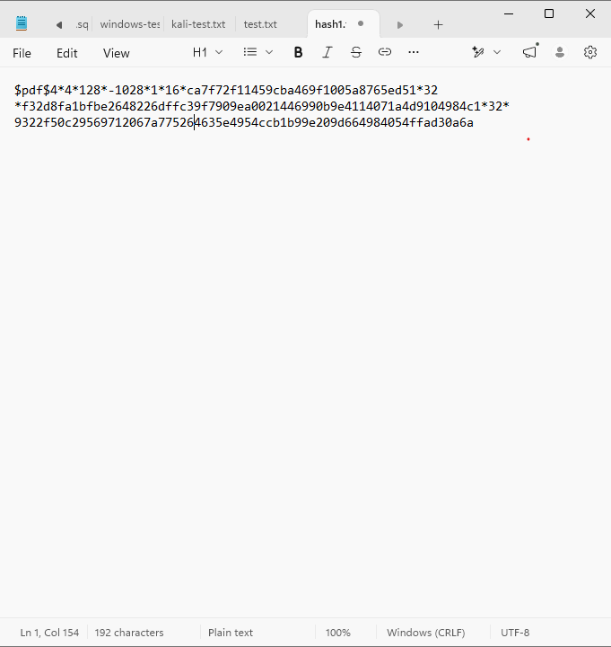
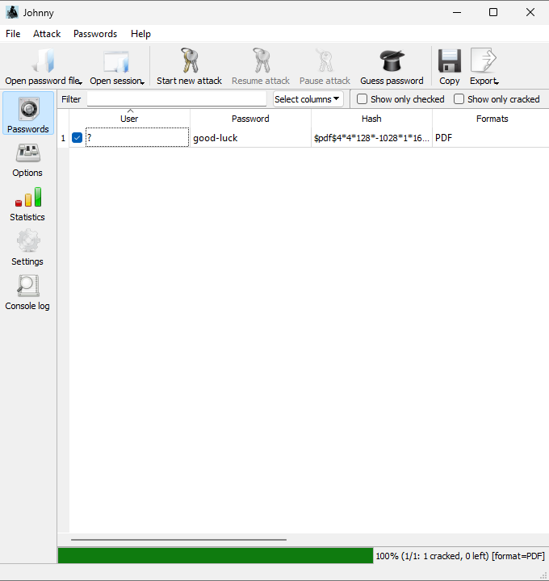
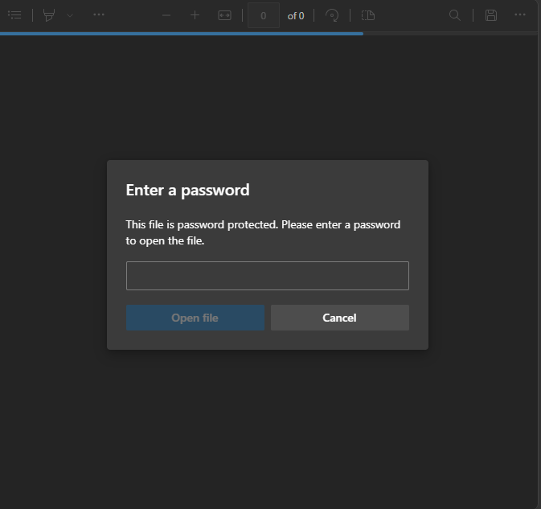
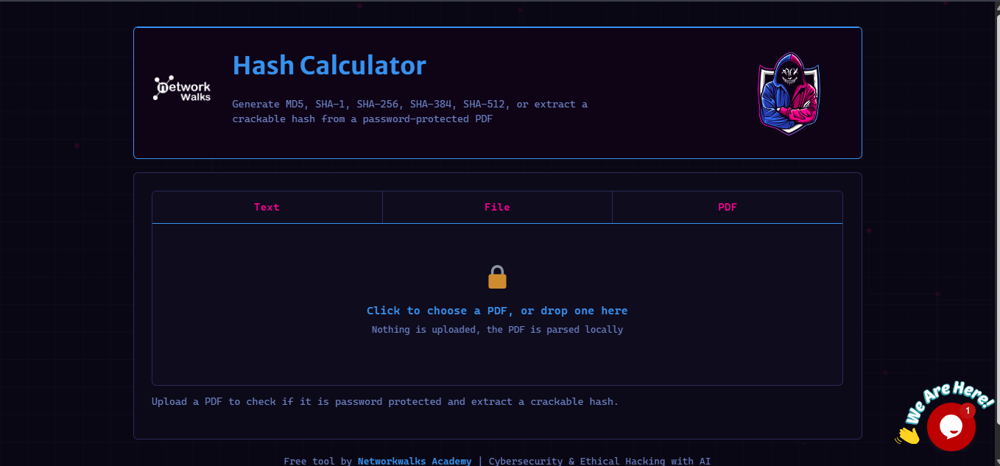
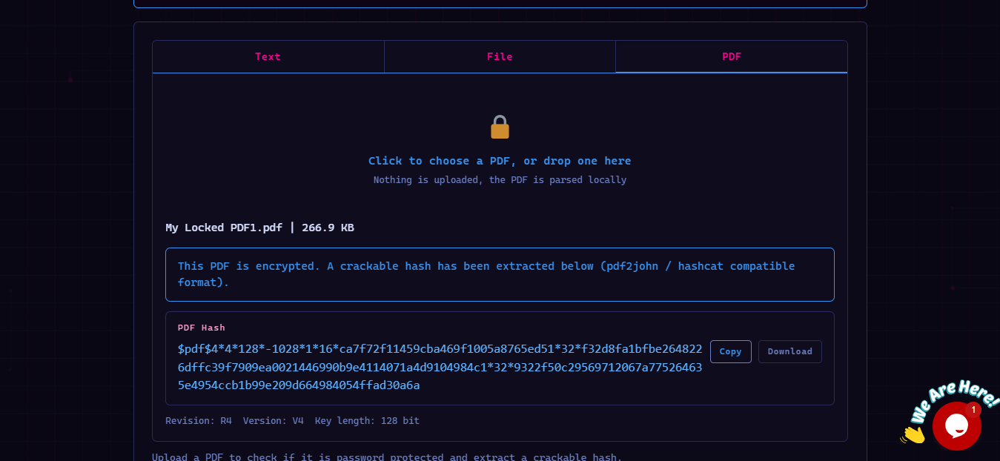
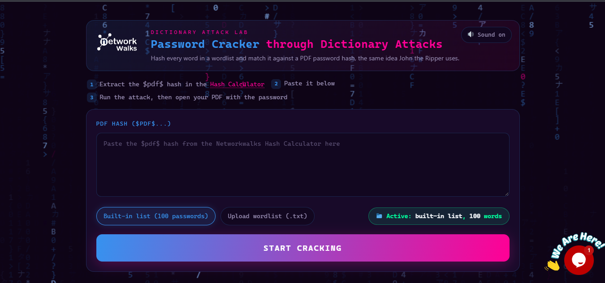

# WEEK 3 – PASSWORD CRACKING PROJECTS

## NetworkWalks Cybersecurity Internship

This repository documents the practical activities completed during **Week 3 of the NetworkWalks Cybersecurity Internship**.

The week's practical work focused on password recovery, PDF hash extraction, wordlist-based password attacks, and the use of password-cracking tools.

Two project modules were completed:

1. **W3-PM1:** Password Cracking with John the Ripper (JTR).
2. **W3-PM2:** Password Cracking with NetworkWalks Tools.

The practical exercises were conducted using the provided password-protected PDF in an authorized learning environment.

---

## 1. PROJECT OBJECTIVES

The main objectives of these practical exercises were to:

- Understand the concept of password hashing and password recovery.
- Extract password hashes from password-protected PDF documents.
- Learn how wordlists are used in password-cracking processes.
- Use John the Ripper and its graphical interface, Johnny.
- Explore NetworkWalks online Hash Calculator and Password Cracker tools.
- Compare different password-cracking approaches.
- Understand the importance of strong passwords and responsible security testing.

---

## 2. TOOLS AND TECHNOLOGIES

The following tools and resources were used:

| Tool | Purpose |
|---|---|
| John the Ripper | Password-cracking engine |
| Johnny GUI | Graphical interface for John the Ripper |
| Online Hash Extractor | Extracting password hashes from PDF files |
| NetworkWalks Hash Calculator | Extracting PDF password hashes |
| NetworkWalks Password Cracker | Testing password hashes against wordlists |
| Notepad | Saving and preparing extracted hash data |
| Web Browser | Accessing online password-cracking tools |
| Windows | Operating environment |

---

# 3. W3-PM1: PASSWORD CRACKING WITH JOHN THE RIPPER

## 3.1 Introduction

This practical focused on recovering the password of a provided password-protected PDF using John the Ripper and its graphical interface, Johnny.

The exercise involved extracting the PDF password hash, saving it in a text file, loading it into Johnny, and performing a password-cracking attack.

## 3.2 Practical Procedure

The following steps were performed:

1. Downloaded the provided password-protected PDF.
2. Downloaded and extracted John the Ripper for Windows.
3. Verified that John the Ripper was working.
4. Installed and launched Johnny GUI.
5. Configured Johnny to use the John the Ripper executable.
6. Extracted the PDF password hash using an online PDF hash extractor.
7. Saved the extracted hash in a file named `hash1.txt`.
8. Loaded the hash into Johnny.
9. Started the password-cracking attack.
10. Used the recovered password to unlock the PDF.

## 3.3 Screenshot Evidence

The following screenshots document the practical process.

### Step 1: Downloading the Protected PDF

### Step 2: John the Ripper Launch

### Step 3: Johnny Configuration

### Step 4: PDF Hash Extraction

### Step 5: Saving the Hash in Notepad

### Step 6: Loading the Hash into Johnny

### Step 7: Password-Cracking Results

### Step 8: Successfully Unlocking the PDF

---

# 4. W3-PM2: PASSWORD CRACKING WITH NETWORKWALKS TOOLS

## 4.1 Introduction

This practical focused on using two online tools provided by NetworkWalks:

- **Hash Calculator:** Used to extract the password hash from the protected PDF.
- **Password Cracker:** Used to test possible passwords against the extracted hash.

Unlike the first practical, this exercise did not require installing password-cracking software locally.

## 4.2 Practical Procedure

The following steps were performed:

1. Downloaded the provided password-protected PDF.
2. Opened the NetworkWalks Hash Calculator.
3. Uploaded the PDF and generated its password hash.
4. Copied the complete extracted hash.
5. Opened the NetworkWalks Password Cracker.
6. Submitted the hash using the built-in wordlist.
7. Observed that the built-in wordlist did not recover the password and returned an unsuccessful result.
8. Uploaded an external wordlist named `JTR_default_password.txt`, containing 3,556 words.
9. Started another password-cracking attempt using the external wordlist.
10. Successfully recovered the password.
11. Used the recovered password to open the protected PDF.

## 4.3 Screenshot Evidence

### Step 1: Downloading the Protected PDF

### Step 2: Opening the Hash Calculator

### Step 3: Extracting the PDF Hash

### Step 4: Opening the Password Cracker

### Step 5: Built-in Wordlist Attempt

### Step 6: Uploading an External Wordlist

### Step 7: Successful Password Recovery

### Step 8: Successfully Unlocking the PDF

---

# 5. COMPARISON OF THE TWO PRACTICALS

| Feature | W3-PM1: John the Ripper | W3-PM2: NetworkWalks |
|---|---|---|
| Main tool | John the Ripper | NetworkWalks tools |
| Interface | Johnny GUI | Web browser |
| Hash extraction | Online PDF hash extractor | NetworkWalks Hash Calculator |
| Password recovery | John the Ripper engine | NetworkWalks Password Cracker |
| Wordlists | John the Ripper attack configuration | Built-in and external wordlists |
| Installation | Required | Not required |

Both practicals demonstrated how password recovery can be performed using extracted password hashes and candidate passwords.

---

# 6. KEY LEARNING OUTCOMES

Through these practical exercises, I gained experience in:

- Understanding the relationship between password hashing and password recovery.
- Extracting password hashes from protected PDF documents.
- Working with John the Ripper and Johnny GUI.
- Configuring a password-cracking environment.
- Understanding how wordlists are used during password attacks.
- Comparing built-in and external wordlists.
- Interpreting unsuccessful and successful password-cracking results.
- Understanding why password complexity matters in information security.

---

# 7. ETHICAL CONSIDERATIONS

Password-cracking techniques can be used for legitimate security testing and educational purposes, but they can also be misused.

All activities documented in this repository were conducted as part of an authorized cybersecurity training exercise using the provided laboratory PDF.

These techniques should only be applied to systems, files, and resources for which explicit authorization has been granted.

---

# 8. REFERENCES AND LEARNING RESOURCES

1. **Openwall – John the Ripper:**  
   https://www.openwall.com/john/

2. **NetworkWalks – Hash Calculator:**  
   https://networkwalks.com/hash-calculator/

3. **NetworkWalks – Password Cracker:**  
   https://networkwalks.com/password-cracker/

4. **NetworkWalks – Password Cracking with NetworkWalks Tools:**  
   https://networkwalks.com/project-task-lab-password-cracking-with-networkwalks-tools/

5. **Online Hash Crack – PDF Hash Extractor:**  
   https://www.onlinehashcrack.com/tools-pdf-hash-extractor.php

---

# 9. AUTHOR INFORMATION

**Name:** MUTSIIRWA MATEMBERA JOSUE

**Program:** NetworkWalks Cybersecurity Internship

**Batch:** B084

**Week:** 03

**Project:** Password Cracking with John the Ripper and NetworkWalks Tools

---

## CONCLUSION

Week 3 provided practical exposure to password recovery techniques through two different approaches: John the Ripper and NetworkWalks online password-cracking tools.

The exercises improved my understanding of password hashes, wordlists, password recovery workflows, and the importance of password security.

This repository serves as documentation and evidence of the practical activities completed during the third week of the cybersecurity internship.
