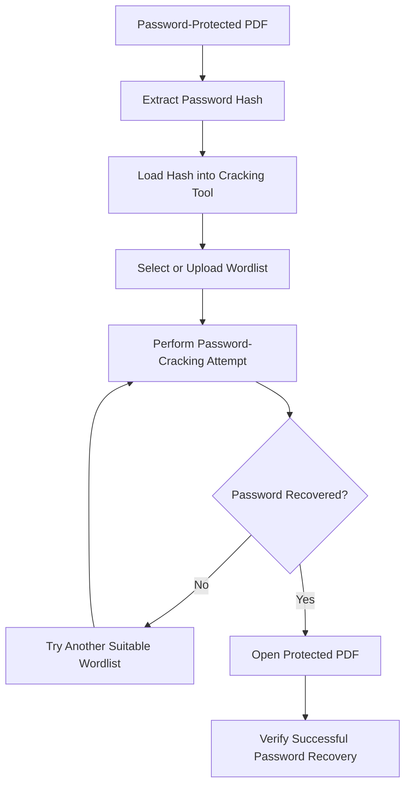
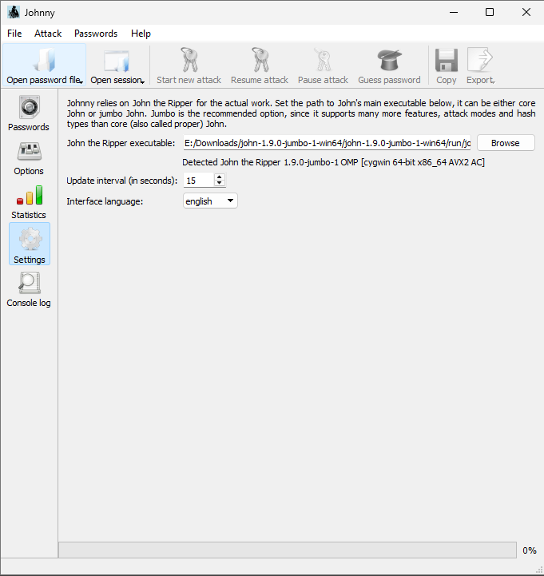
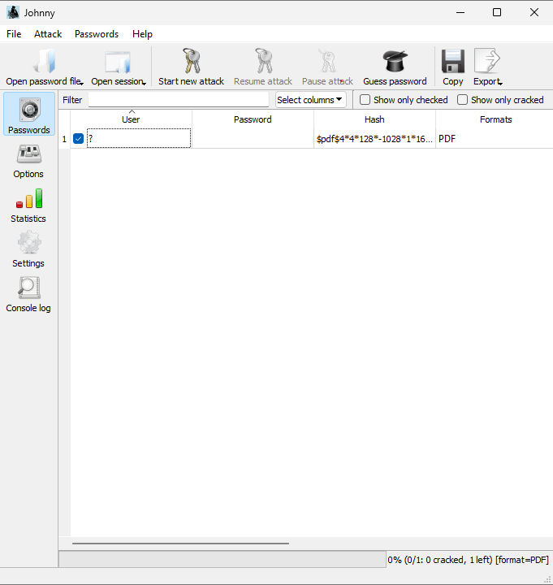
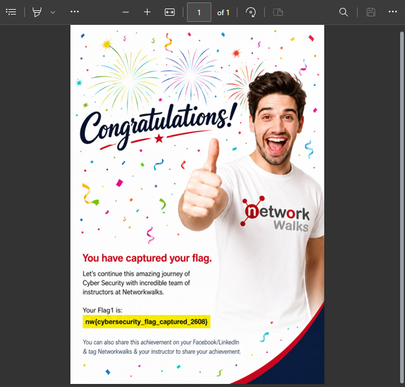
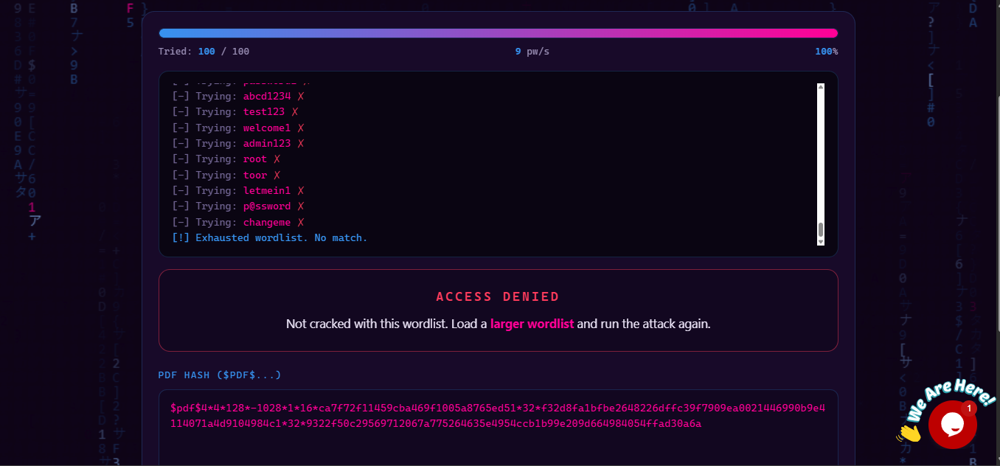
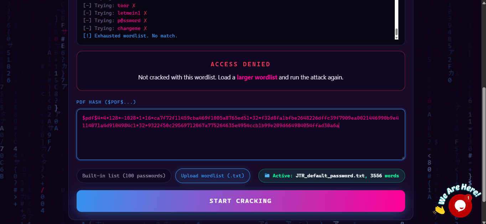

# WEEK 3 — PASSWORD CRACKING PROJECTS

  
  
  
  

  
  
  

---

## 1. PROJECT OVERVIEW

This repository contains the practical projects completed during **Week 3 of the NetworkWalks Cybersecurity Internship**.

The week's activities focused on password recovery and password-cracking techniques using two different approaches:

- **W3-PM1:** Password cracking using John the Ripper and its graphical interface, Johnny.
- **W3-PM2:** Password cracking using NetworkWalks online tools and an external wordlist.

Both practical exercises involved extracting a password hash from a protected PDF document, performing password-recovery attempts, and verifying the recovered password by successfully opening the document.

The purpose of these exercises was to understand how password hashes, wordlists, and password-cracking tools work in a controlled learning environment.

## 2. PROJECT OBJECTIVES

The main objectives of these practical exercises were to:

- Understand the concept of password hashing.
- Extract password hashes from password-protected PDF files.
- Become familiar with John the Ripper.
- Configure and use Johnny as a graphical interface for John the Ripper.
- Understand dictionary-based password attacks.
- Use built-in and external wordlists.
- Compare local password-cracking software with online password-cracking tools.
- Verify password recovery by opening the protected PDF document.

## 3. TOOLS AND TECHNOLOGIES

The following tools and resources were used during the projects:

| Tool / Resource | Purpose |
|---|---|
| John the Ripper | Password-cracking software |
| Johnny | Graphical interface for John the Ripper |
| NetworkWalks Hash Calculator | Extracting password hashes |
| NetworkWalks Password Cracker | Performing password-recovery attempts |
| PDF Hash Extractor | Extracting the PDF password hash |
| JTR Default Password List | External wordlist used during the exercise |
| Windows | Operating system used for the local JTR practical |
| Web Browser | Accessing the online tools |

## 4. UNDERSTANDING THE PASSWORD-RECOVERY PROCESS

Both projects followed a general password-recovery process:

A password hash is a representation of a password produced by a hashing process. Password-cracking tools can test candidate passwords against the hash to determine whether a candidate matches the original password.

A wordlist contains possible password candidates that a cracking tool can test during a dictionary-based attack.

---

# 5. W3-PM1 — PASSWORD CRACKING WITH JOHN THE RIPPER

## 5.1 Project Description

The first practical exercise focused on using **John the Ripper (JTR)** to recover the password of a protected PDF document.

The exercise was performed locally on Windows. Johnny was used as the graphical interface to configure and manage the password-cracking process.

## 5.2 Tools Used

- John the Ripper
- Johnny GUI
- PDF Hash Extractor
- Notepad
- Password-protected PDF document

## 5.3 Practical Procedure

The following steps were completed:

1. Downloaded the password-protected PDF document.
2. Launched Johnny.
3. Configured Johnny with the location of the John the Ripper executable.
4. Used a PDF hash extraction tool to extract the password hash.
5. Saved the extracted hash in a text file named `hash1.txt`.
6. Loaded the hash file into Johnny.
7. Configured and started the password-cracking attack.
8. Opened the PDF document after recovering its password to verify the result.

## 5.4 Screenshots and Evidence

### Step 1 — PDF Downloaded

The protected PDF document was downloaded and prepared for the practical exercise.

### Step 2 — Johnny Launched

Johnny was launched to provide a graphical interface for working with John the Ripper.

### Step 3 — Johnny Configuration

The John the Ripper executable location was configured in Johnny.

### Step 4 — PDF Hash Extraction

The password hash was extracted from the protected PDF using a PDF hash extraction tool.

### Step 5 — Hash Saved in Notepad

The extracted hash was saved in a text file named `hash1.txt`.

### Step 6 — Hash Loaded into Johnny

The saved hash file was loaded into Johnny in preparation for the password-cracking attempt.

### Step 7 — Attack Results

The password-cracking process was executed using the configured tool.

### Step 8 — PDF Successfully Unlocked

The recovered password was used to open the protected PDF document, confirming successful password recovery.

## 5.5 Project Outcome

The practical exercise demonstrated how John the Ripper and Johnny can be used to perform password-recovery operations against a password-protected PDF.

The successful opening of the PDF document provided evidence that the password-recovery process had worked.

---

# 6. W3-PM2 — PASSWORD CRACKING WITH NETWORKWALKS TOOLS

## 6.1 Project Description

The second practical exercise focused on using NetworkWalks online tools to extract and crack the password hash of a protected PDF document.

Unlike the first project, which used locally installed software, this exercise used browser-based tools provided by NetworkWalks.

The practical also demonstrated the difference between using a built-in wordlist and uploading an external wordlist.

## 6.2 Tools Used

- NetworkWalks Hash Calculator
- NetworkWalks Password Cracker
- JTR Default Password List
- Web Browser
- Password-protected PDF document

## 6.3 Practical Procedure

The following steps were completed:

1. Downloaded the protected PDF document.
2. Opened the NetworkWalks Hash Calculator.
3. Uploaded the PDF document and extracted its password hash.
4. Copied the extracted hash, which began with `$pdf$`.
5. Opened the NetworkWalks Password Cracker.
6. Loaded the extracted hash into the password-cracking tool.
7. Attempted password recovery using the built-in wordlist.
8. Observed that the built-in wordlist attempt was unsuccessful.
9. Downloaded and uploaded the external wordlist `JTR_default_password.txt`, containing 3,556 words.
10. Started another password-cracking attempt using the external wordlist.
11. Recovered the password and used it to open the protected PDF document.

## 6.4 Screenshots and Evidence

### Step 1 — PDF Downloaded

The password-protected PDF document was downloaded for the exercise.

### Step 2 — Hash Calculator Opened

The NetworkWalks Hash Calculator was opened to prepare for hash extraction.

### Step 3 — PDF Hash Extracted

The PDF document was uploaded, and its password hash was extracted.

### Step 4 — Password Cracker Opened

The NetworkWalks Password Cracker was opened to begin the password-recovery process.

### Step 5 — Built-in Wordlist Attempt Unsuccessful

The first password-cracking attempt was performed using the built-in wordlist. The attempt did not recover the password.

### Step 6 — External Wordlist Uploaded

An external wordlist named `JTR_default_password.txt`, containing 3,556 words, was uploaded for another attempt.

### Step 7 — Password Successfully Cracked

The password-cracking attempt using the external wordlist successfully recovered the password.

### Step 8 — PDF Successfully Unlocked

The recovered password was entered, and the protected PDF document opened successfully.

## 6.5 Project Outcome

The practical exercise demonstrated how online password-cracking tools can be used to extract password hashes and perform dictionary-based password-recovery attempts.

It also showed that a built-in wordlist may not contain the required password, while a different wordlist may successfully recover it.

---

# 7. COMPARISON OF THE TWO PROJECTS

Both projects focused on recovering the password of a protected PDF document, but they used different tools and environments.

| Comparison | W3-PM1 | W3-PM2 |
|---|---|---|
| Approach | Local password cracking | Online password cracking |
| Main Tool | John the Ripper | NetworkWalks Password Cracker |
| Interface | Johnny GUI | Web interface |
| Hash Extraction | PDF Hash Extractor | NetworkWalks Hash Calculator |
| Wordlist | Configured cracking attack | Built-in and external wordlists |
| Environment | Windows | Web Browser |
| Verification | PDF opened successfully | PDF opened successfully |

## 8. KEY LEARNING OUTCOMES

Through these practical exercises, I gained experience in the following areas:

- Understanding password hashes and their role in password protection.
- Extracting password hashes from protected PDF documents.
- Using John the Ripper for password-recovery exercises.
- Configuring Johnny to work with John the Ripper.
- Loading password hashes into cracking tools.
- Understanding dictionary-based password attacks.
- Working with built-in and external wordlists.
- Understanding why one wordlist may fail while another succeeds.
- Comparing locally installed security tools with online tools.
- Verifying password recovery by opening a protected document.

## 9. ETHICAL CONSIDERATIONS

Password-cracking tools are legitimate cybersecurity tools when used for authorized security testing, password recovery, and educational purposes.

However, they can also be misused if applied to systems or documents without permission.

All activities documented in this repository were performed as part of a cybersecurity learning exercise.

These techniques should only be applied to files, systems, and environments that the user owns or has explicit authorization to test.

## 10. REFERENCES AND LEARNING RESOURCES

The following resources were used during the practical exercises:

1. **John the Ripper — Official Website**  
   https://www.openwall.com/john/

2. **NetworkWalks Hash Calculator**  
   https://networkwalks.com/hash-calculator/

3. **NetworkWalks Password Cracker**  
   https://networkwalks.com/password-cracker/

4. **NetworkWalks Password Cracking Project Instructions**  
   https://networkwalks.com/project-task-lab-password-cracking-with-networkwalks-tools/

5. **Online PDF Hash Extractor**  
   https://www.onlinehashcrack.com/tools-pdf-hash-extractor.php

## 11. CONCLUSION

Week 3 provided practical experience with password-recovery techniques using both locally installed and online cybersecurity tools.

The two projects demonstrated the importance of password hashes, wordlists, and dictionary-based attacks in understanding password security.

By completing these exercises, I gained practical familiarity with John the Ripper, Johnny, and NetworkWalks password-cracking tools.

These activities strengthened my understanding of basic password security concepts and provided a foundation for further learning in cybersecurity and ethical penetration testing.

---

## 12. AUTHOR INFORMATION

**Name:** MUTSIIRWA MATEMBERA JOSUE

**Program:** NetworkWalks Cybersecurity Internship

**Batch:** B084

**Project:** Week 3 — Password Cracking Projects

**GitHub:** [github.com/josuemutsiirwa](https://github.com/josuemutsiirwa)

**LinkedIn:** [View my LinkedIn Profile](https://www.linkedin.com/in/josue-matembera-37a269407/)
